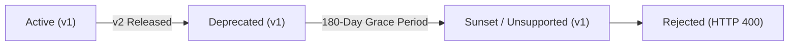

# ProofMesh Event Schema Evolution & Deprecation Policy

**Document:** `docs/api/schema-evolution.md`  
**Version:** 1.0.0-GA  
**Status:** Approved Engineering & Governance Policy  
**Author:** Lead Software Architect & Integration Engineer

---

## 1. Overview & Semantic Versioning

ProofMesh is an integration-first governance platform. External agents, CI/CD pipelines, runtime adapters, and telemetry collectors continuously publish events into the Integration Gateway.

To protect historical audit immutability, prevent data poisoning, and ensure zero-downtime evolution across distributed multi-tenant environments, ProofMesh enforces strict **Semantic Schema Evolution** rules.

---

## 2. Schema Compatibility Rules

### 2.1 Backward-Compatible Additive Evolution (Same Major Version: e.g. `1.0.0` -> `1.1.0`)

A schema change is **backward-compatible** if existing consumers and producers can continue processing messages without modification.

Allowed additive changes:

- Adding a new optional field with a sensible default (`.optional()` or `.default(...)`).
- Adding a new allowed enum value to consumer schemas (producers must remain on the agreed set until consumers are updated).
- Relaxing non-breaking validation constraints (e.g., increasing `max` string length from 100 to 255).
- Registering a new independent event type (e.g. `io.proofmesh.new_feature.v1`).

### 2.2 Breaking Changes (Major Version Increment: e.g. `v1` -> `v2`)

A schema change is **breaking** if it invalidates existing serialized payloads or breaks consumer expectations.

Breaking changes include:

- Removing or renaming an existing required or optional field.
- Changing a field's data type (e.g., string UUID to integer ID).
- Narrowing validation constraints (e.g., shortening max length or adding a restrictive regex).
- Removing an enum value from an event schema.
- Changing the semantic interpretation of a field.

Breaking changes **strictly require**:

1. A new namespaced event type with an incremented major version suffix (e.g., `io.proofmesh.claim.registered.v2`).
2. A formal Architectural Decision Record (ADR) under `docs/adr/`.
3. Simultaneous registration of both `v1` and `v2` schemas in [`EventSchemaRegistry`](file:///packages/domain/src/gateway/schema-registry.ts).

---

## 3. Unsupported Schema Version Rejection

Operating Rule 1 requires that all external inputs are strictly validated at trust boundaries.

If an incoming event specifies an unsupported or unknown schema version:

1. The Integration Gateway immediately rejects the request with HTTP 400 Bad Request.
2. The response returns an **RFC 7807 Problem Details** object:
   ```json
   {
     "type": "https://proofmesh.io/errors/unsupported-schema-version",
     "title": "Unsupported Schema Version",
     "status": 400,
     "code": "UNSUPPORTED_SCHEMA_VERSION",
     "detail": "Unsupported schema version '3.0.0' for event type 'io.proofmesh.claim.registered.v1'. Supported versions: [1.0.0, 1.0, v1]",
     "timestamp": "2026-11-05T08:30:00.000Z"
   }
   ```
3. An audit rejection metric is incremented for integration diagnostics.

---

## 4. Deprecation & Sunset Lifecycle

When a major version increment occurs (e.g., `v2` is published), the prior version (`v1`) enters the **Deprecation Lifecycle**:



1. **Deprecation Notice**: The prior version is marked as deprecated using `EventSchemaRegistry.markDeprecated(eventType, version, sunsetDate)`.
2. **Gateway Response Header**: During the deprecation window, HTTP responses include standard deprecation headers:
   - `Deprecation: @<timestamp>`
   - `Sunset: <RFC 7231 Date>`
   - `Link: </schemas/v2/...>; rel="successor-version"`
3. **Mandatory 180-Day Grace Period**: Deprecated event versions remain fully supported for ingestion for at least 180 calendar days.
4. **Sunset Execution**: Upon sunset date arrival, the deprecated schema is unregistered and subsequent submissions receive HTTP 400 `UNSUPPORTED_SCHEMA_VERSION`.

---

## 5. Consumer Robustness Principles

To prevent producer evolution from crashing downstream consumers:

1. **Tolerant Reader**: Consumers parse payloads with tolerant schemas, ignoring unrecognized fields.
2. **Schema Registry Validation**: All gateway ingress points use [`EventSchemaRegistry.validate`](file:///packages/domain/src/gateway/schema-registry.ts) before persisting to the transactional inbox.
3. **Immutability Protection**: Historical payloads in `inbox_events`, `outbox_events`, and `audit_events` preserve their original schema version string and content hash indefinitely.
