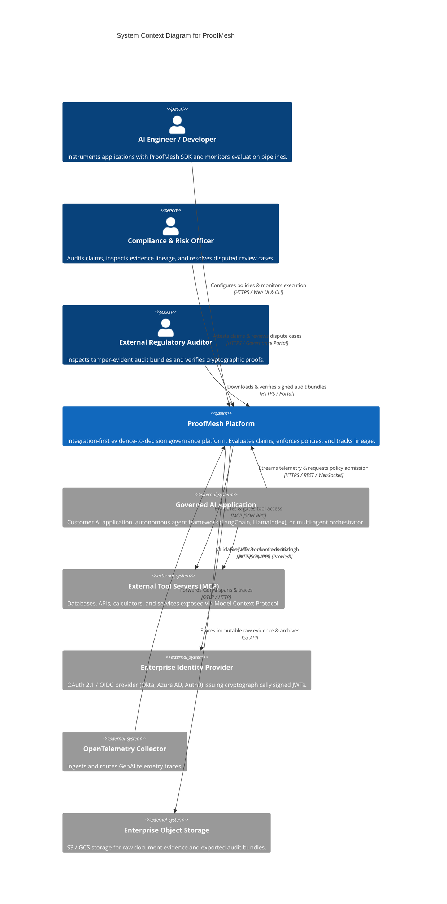

# ProofMesh C4 Model: System Context (Level 1)

**Document:** `docs/architecture/c4-context.md`  
**Version:** 1.0.0-PROPOSED  
**Date:** 2026-11-04  
**Author:** Lead Software Architect and Engineering Orchestrator  
**Status:** Baselined Architecture Specification

---

## 1. System Context Diagram

The System Context diagram illustrates ProofMesh in relation to its human users, governed AI applications, model providers, and external enterprise systems.

---

## 2. External System Actors & Boundaries

| Actor / External System     | Interaction Role                                                                               | Protocols & Interfaces                                  | Trust Level                                         |
| :-------------------------- | :--------------------------------------------------------------------------------------------- | :------------------------------------------------------ | :-------------------------------------------------- |
| **Governed AI Application** | Initiates claims, streams runtime traces, queries policy admission before tool execution.      | REST API (`/v1/claims`, `/v1/evidence`), SDK, WebSocket | Untrusted client (requires JWT & schema validation) |
| **OpenTelemetry Collector** | Aggregates and forwards distributed LLM spans (`gen_ai.*`).                                    | OTLP HTTP / gRPC                                        | Untrusted stream (validated at gateway)             |
| **MCP Tool Servers**        | External capabilities executed by agents under ProofMesh policy supervision.                   | JSON-RPC 2.0 over stdio or SSE/HTTP                     | Semi-trusted (monitored & gated by PEP)             |
| **Compliance Officer**      | Reviews flagged disputes, resolves review cases, and provides authoritative human attestation. | HTTPS Web Portal (React/Vite)                           | Trusted Authenticated Human                         |
| **Regulatory Auditor**      | Inspects append-only audit ledgers and verifies offline cryptographic bundles.                 | HTTPS Web Portal / Verification CLI                     | Read-only Authenticated Principal                   |
| **Enterprise IdP**          | Authenticates users and service accounts; provides token signing keys.                         | OIDC / OAuth 2.1 / JWKS                                 | Authoritative Identity Source                       |
| **Object Storage**          | Stores raw evidence blobs, source documents (PDFs), and signed bundles.                        | S3 API / Blob Storage                                   | High Durability Storage Tier                        |
