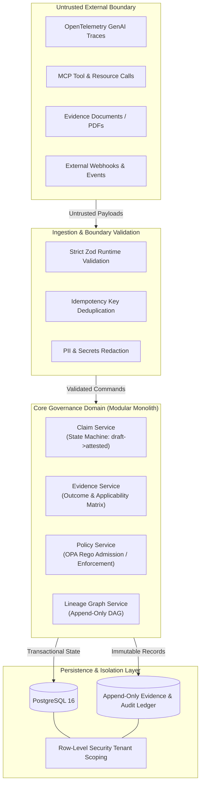

# Architectural Baseline & Current State Assessment

**Document:** `docs/architecture/current-state.md`  
**Date:** 2026-11-04  
**Author:** Lead Software Architect and Engineering Orchestrator  
**Status:** Baselined

---

## 1. Architectural Baseline: Current State

As of the conclusion of Phase 0, ProofMesh exists in a **clean, structured pre-implementation state**:

- **Repository Isolation**: Git root established at `/Users/rishisingh/ProofMesh/.git` with branch `main`.
- **Governance Infrastructure**: Authoritative instruction file [`AGENTS.md`](file:///Users/rishisingh/ProofMesh/AGENTS.md), single-source-of-truth pointer [`GEMINI.md`](file:///Users/rishisingh/ProofMesh/GEMINI.md), 8 bounded subagent definitions in [`.agents/agents/`](file:///Users/rishisingh/ProofMesh/.agents/agents/), 4 reusable skills in [`.agents/skills/`](file:///Users/rishisingh/ProofMesh/.agents/skills/), and 5 scoped engineering rules in [`.agents/rules/`](file:///Users/rishisingh/ProofMesh/.agents/rules/).
- **Application Code**: Zero production code or database migrations currently exist. No legacy technical debt or architectural drift is present.

---

## 2. Architectural Gap Analysis & Structural Principles

To ensure ProofMesh satisfies its mission as an enterprise AI evidence-to-decision governance platform, this analysis establishes the system boundaries and consistency guarantees required before writing Phase 1 code.



---

## 3. Transactional Consistency Requirements

Transactional consistency (ACID) is non-negotiable for specific governance domains, while eventual consistency is optimal for telemetry streams:

| Subsystem                         | Consistency Model                       | Rationale & Mechanism                                                                                                                                                                                                    |
| :-------------------------------- | :-------------------------------------- | :----------------------------------------------------------------------------------------------------------------------------------------------------------------------------------------------------------------------- |
| **Claim Lifecycle State Machine** | **Strict Immediate Consistency (ACID)** | State transitions (`submitted` -> `evaluating` -> `attested` / `disputed`) govern high-stakes compliance and policy decisions. Must use database row locks (`SELECT FOR UPDATE`) within a single transactional boundary. |
| **Policy Enforcement Evaluation** | **Strict Immediate Consistency**        | Synchronous enforcement decisions (`admit`, `deny`, `require_human_review`) cannot tolerate stale policy bundle evaluations. Evaluated atomically against the current claim revision.                                    |
| **Evidence Ledger & Audit Log**   | **Append-Only Immutability**            | Cryptographic hash blocks and audit entries must be written atomically with state transitions. Records are never updated or deleted.                                                                                     |
| **Telemetry Ingestion Queue**     | **Eventual Consistency**                | High-throughput OpenTelemetry spans and background trace ingestion are buffered asynchronously and ingested without blocking calling applications.                                                                       |

---

## 4. Asynchronous Observation vs. Synchronous Enforcement

ProofMesh enforces a strict architectural partition between observation and enforcement:

### 4.1 Asynchronous Observation (Default: 95% of traffic)

- **Design Rule**: Observation, trace collection, and evidence logging must be non-blocking.
- **Transport**: Asynchronous HTTP endpoint or message queue (`/v1/telemetry/events`).
- **Failure Behavior**: **Fail-Open by design**. If ProofMesh telemetry ingestion is under maintenance or degraded, governed client applications must continue executing their AI workflows without interruption.
- **Latency Budget**: Request parsing and queue handoff < 5ms.

### 4.2 Synchronous Enforcement (Explicitly Configured: 5% of traffic)

- **Design Rule**: Applied only when client systems explicitly configure gatekeeper checks (e.g., admitting a tool invocation or publishing an AI-generated legal document).
- **Transport**: Synchronous REST / JSON-RPC endpoint (`/v1/policy/evaluate`).
- **Failure Behavior**: **Explicitly Configured Fail-Open or Fail-Closed**. Each policy admission rule declares whether timeout or service failure results in an admission permit or block.
- **Latency Budget**: In-process policy evaluation < 25ms.

---

## 5. Multi-Tenant Isolation & Privacy Boundaries

### Boundary Protections

1. **Server-Side Context Binding**: Tenant identity is extracted solely from cryptographically verified authentication tokens (JWT or API keys). The tenant context is bound to the async execution storage (Node.js `AsyncLocalStorage`) and passed deterministically to all services.
2. **Database-Level Isolation**:
   - Every database table storing tenant data includes a `tenant_id` foreign key.
   - PostgreSQL Row-Level Security (RLS) is enabled on all tables:
     ```sql
     ALTER TABLE claims ENABLE ROW LEVEL SECURITY;
     CREATE POLICY tenant_isolation_policy ON claims
       FOR ALL USING (tenant_id = current_setting('app.current_tenant_id', true)::uuid);
     ```
3. **Data Privacy & Sanitization**:
   - Telemetry payloads are passed through an in-memory PII and secret redaction filter before persistence.
   - Raw prompts containing sensitive user data are hashed (SHA-256) with tenant-isolated salts when full-text storage is not explicitly enabled.

---

## 6. Duplication Risks & Ingestion Idempotency

### Problem Statement

Distributed AI frameworks and webhook transports operate under **at-least-once** delivery semantics. Retries caused by network blips can cause duplicate evidence submissions or duplicate policy evaluations.

### Architectural Solution

- **Mandatory Idempotency Keys**: All write endpoints require an `Idempotency-Key` HTTP header.
- **Unique Constraint at Storage Layer**:
  ```sql
  CREATE UNIQUE INDEX idx_events_tenant_idempotency
    ON ingestion_events (tenant_id, idempotency_key);
  ```
- **Replay Protection**: If a duplicate key is presented within the idempotency retention window (e.g. 24 hours), the server returns the cached prior response without re-triggering policy evaluation or state machine transitions.

---

## 7. Recommended Architecture: Modular Monolith

Per Operating Rule 4 (_"Prefer the simplest reliable design that satisfies the requirement. Avoid needless microservices, generic frameworks, abstractions, wrappers, speculative features and duplicate packages"_):

### Architectural Recommendation

ProofMesh will be structured as a **Modular Monolith** in TypeScript:

- **Single Deployable Unit**: Minimizes deployment complexity, operational cost, and network latency during initial phases.
- **Strict Module Boundaries**: Domain logic encapsulated in cohesive modules (`modules/claims/`, `modules/evidence/`, `modules/policy/`, `modules/lineage/`, `modules/integrations/`).
- **Internal Contract Enforcement**: Modules interact exclusively through typed public interfaces, never through direct database table tampering.
- **Path to Microservices**: If a specific module (e.g. Telemetry Ingestion) later requires independent scaling, its strict interface boundary allows it to be extracted into a standalone service with zero domain rewrites.
