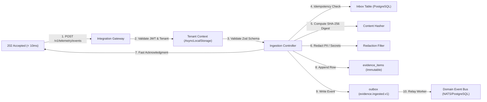
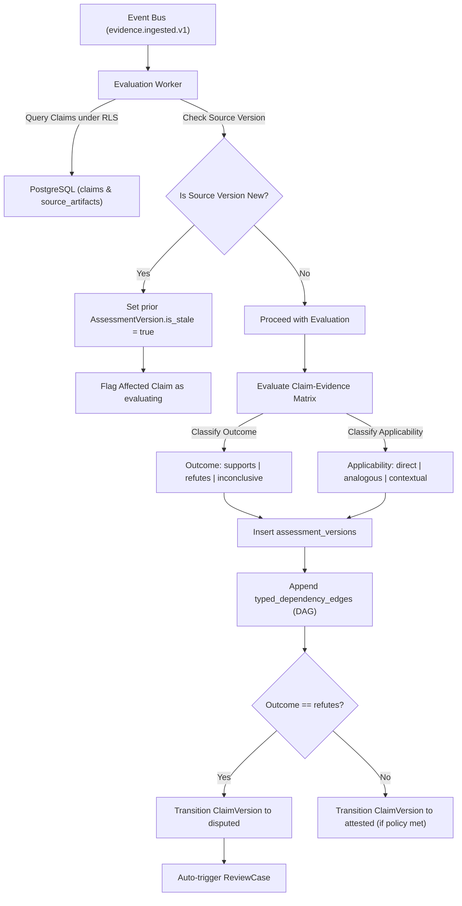
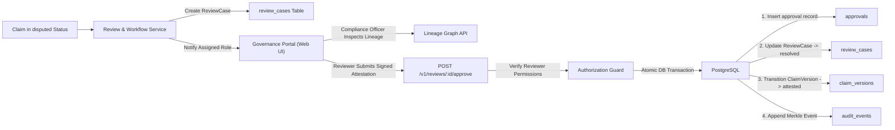
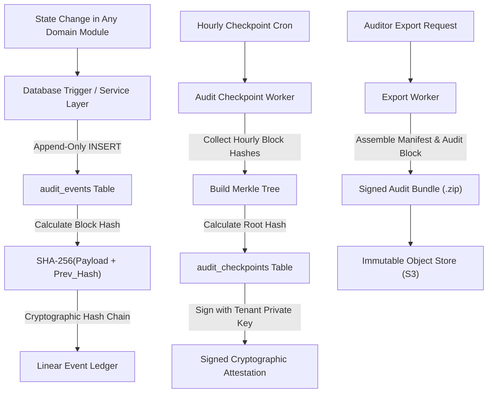

# ProofMesh Data Flow Architecture

**Document:** `docs/architecture/data-flow.md`  
**Version:** 1.0.0-PROPOSED  
**Date:** 2026-11-04  
**Author:** Lead Software Architect and Engineering Orchestrator  
**Status:** Baselined Architecture Specification

---

## 1. Executive Summary & Core Data Pipelines

ProofMesh coordinates five core data flow pipelines designed to satisfy the competing requirements of high-throughput non-blocking observation (< 5ms overhead) and sub-25ms synchronous policy enforcement:

1. **Asynchronous Telemetry Ingestion Pipeline (Non-Blocking)**
2. **Synchronous Policy Gatekeeping Pipeline (Inline PEP)**
3. **Evidence Correlation & Claim Evaluation Pipeline**
4. **Human Review, Dispute & Attestation Pipeline**
5. **Audit Ledger & Merkle Checkpoint Pipeline**

---

## 2. Pipeline 1: Asynchronous Telemetry Ingestion Pipeline

This pipeline handles OTel GenAI spans, tool execution events, and document updates without introducing latency or fragility into client applications.



### Transformation Stages

1. **Header & Context Extraction**: Extracts `Authorization`, `X-Tenant-ID` (validated against JWT claims), and `Idempotency-Key`.
2. **Idempotency Verification**: Checks `inbox_events`. If duplicate, immediately returns original 202 payload with `X-ProofMesh-Duplicate: true`.
3. **Cryptographic Fingerprinting**: Calculates `SHA-256(raw_payload_bytes)` before any modifications to ensure verifiable data provenance.
4. **In-Flight Sanitization**: Runs PII detection filters (regex for SSNs, credit cards, emails) and secrets scanners (Bearer tokens, AWS keys). Masks sensitive tokens unless raw storage is configured.
5. **Transactional Ingestion**: Simultaneously writes the `EvidenceItem` and the `outbox` event within a single PostgreSQL transaction.

---

## 3. Pipeline 2: Synchronous Policy Gatekeeping Pipeline

This pipeline provides inline admission control for high-risk tool invocations or sensitive document publications.

```mermaid
flowchart TD
    A["Agent Tool Interceptor / MCP Gateway"] -->|1. Tool Execution Request| B["Policy Enforcement Point (PEP)"]
    B -->|2. Extract Action & Parameters| C["Input Context Normalizer"]
    C -->|3. Query In-Memory Policy Bundle| D["In-Process OPA Wasm Runtime"]

    D -->|4. Evaluate Rego Rules (< 2ms)| E{"Policy Disposition"}

    E -->|admit| F["Forward Request to Target Tool Server"]
    F -->|Return Tool Output| A

    E -->|deny| G["Block Request with 403 Forbidden & Violation Reason"]
    G --> A

    E -->|require_human_review| H["Create ReviewCase & Return 202 Pending Token"]
    H --> A

    D -.->|Async Logging| I["outbox (policy.evaluated.v1)"]
    I -.->|Background Worker| J["policy_evaluations Table (PostgreSQL)"]
```

### Latency Budget Allocation (< 25ms SLA)

- **Transport & TLS Termination**: 2ms
- **Authentication & Tenant Binding**: 2ms
- **Zod Input Schema Validation**: 1ms
- **In-Process OPA Wasm Policy Evaluation**: 2ms
- **Response Packaging & Async Outbox Queue**: 2ms
- **Total ProofMesh Overhead**: **~9ms** (well within the 25ms SLA budget).

---

## 4. Pipeline 3: Evidence Correlation & Claim Evaluation Pipeline

This asynchronous pipeline evaluates ingested evidence against active claims, establishes lineage graph edges, and detects stale assessments.



---

## 5. Pipeline 4: Human Review & Attestation Pipeline

This pipeline governs human-in-the-loop dispute resolution, quorum reviews, and tamper-evident sign-offs.



---

## 6. Pipeline 5: Audit Ledger & Merkle Checkpointing Pipeline

This pipeline guarantees historical non-repudiation and provides exportable compliance packages.



---

## 7. Storage Tier Data Partitioning & Retention

| Data Classification              | Storage Medium               | Immutability Mechanism              | Retention Policy                                        |
| :------------------------------- | :--------------------------- | :---------------------------------- | :------------------------------------------------------ |
| **Claim & Decision Versions**    | PostgreSQL (Relational)      | DB triggers block `UPDATE`/`DELETE` | Indefinite / Configurable per tenant (default: 7 years) |
| **Evidence Metadata & Hashes**   | PostgreSQL (Relational)      | DB triggers block `UPDATE`/`DELETE` | Permanent audit record                                  |
| **Raw Evidence Payloads / PDFs** | S3-Compatible Object Store   | S3 Object Lock (Compliance Mode)    | Tenant-configurable (30 days to 7 years)                |
| **Lineage DAG Edges**            | PostgreSQL (Adjacency table) | Append-only index                   | Permanent                                               |
| **Audit Ledger & Checkpoints**   | PostgreSQL + S3 Merkle Root  | Cryptographic hash chaining         | Permanent immutable ledger                              |
| **Ephemeral Ingestion Inbox**    | PostgreSQL (`inbox_events`)  | Automated partition drop            | Rolling 7-day retention                                 |
