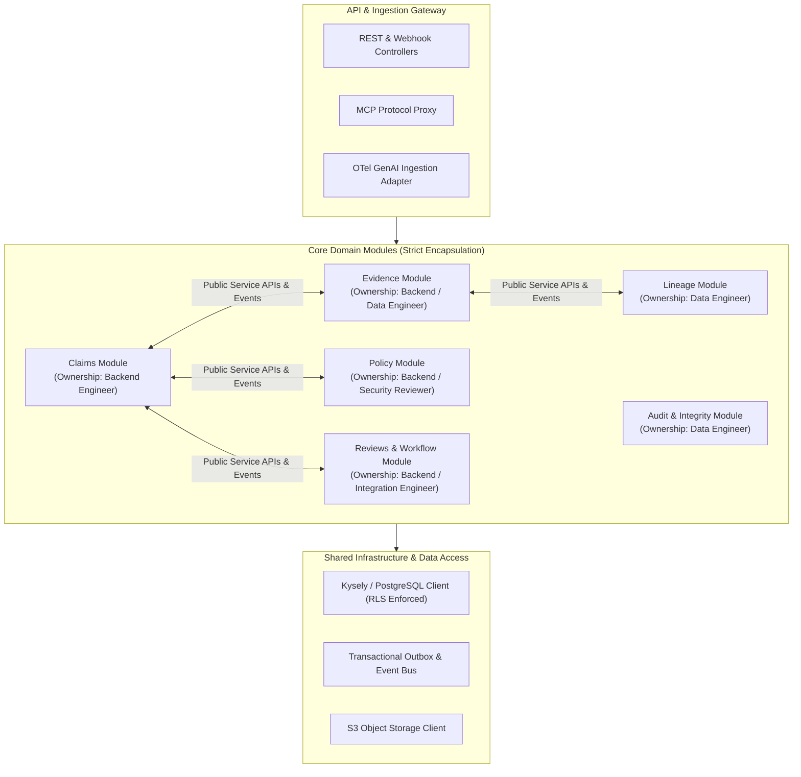

# ProofMesh Module Ownership & Interface Boundaries

**Document:** `docs/architecture/module-ownership.md`  
**Version:** 1.0.0-PROPOSED  
**Date:** 2026-11-04  
**Author:** Lead Software Architect and Engineering Orchestrator  
**Status:** Baselined Architecture Specification

---

## 1. Modular Monolith Architecture

ProofMesh organizes its backend codebase as a cohesive **Modular Monolith** within a unified TypeScript codebase. Each module represents an autonomous bounded domain context with:

- Dedicated domain entities and state machines.
- Pure application services encapsulating all business logic.
- An explicit public interface (`index.ts`) defining exported types and services.
- Strict encapsulation preventing cross-module database table queries.

---

## 2. Module Boundaries & Ownership Matrix

| Module Directory        | Primary Domain Focus                                                                 | Responsible Subagent                            | Public Interface Exports                                 | Forbidden Cross-Dependencies                                                  |
| :---------------------- | :----------------------------------------------------------------------------------- | :---------------------------------------------- | :------------------------------------------------------- | :---------------------------------------------------------------------------- |
| `src/modules/claims/`   | Claim concepts, versions, occurrences, and lifecycle state machine.                  | **Backend Engineer**                            | `ClaimService`, `ClaimVersionDTO`, `claimEvents`         | Must not query `evidence_items` table directly (must call `EvidenceService`). |
| `src/modules/evidence/` | Raw evidence ingestion, SHA-256 digests, document extraction (`unpdf`), assessments. | **Data Engineer** & **Backend Engineer**        | `EvidenceService`, `AssessmentService`, `evidenceEvents` | Must not directly mutate `claim_versions.status`.                             |
| `src/modules/policy/`   | In-process OPA Wasm evaluator, bundle management, synchronous PEP hooks.             | **Backend Engineer**                            | `PolicyService`, `PolicyEvaluationDTO`                   | Must not store business claims or tenant configurations directly.             |
| `src/modules/lineage/`  | Adjacency DAG persistence, recursive CTE traversals, coverage records.               | **Data Engineer**                               | `LineageService`, `LineageGraphDTO`, `CoverageRecordDTO` | Must not perform policy evaluation or claim transitions.                      |
| `src/modules/reviews/`  | Human review cases, reviewer assignments, approval quorums, escalations.             | **Integration Engineer** & **Backend Engineer** | `ReviewService`, `ApprovalService`, `reviewEvents`       | Must not bypass claim state machine guards.                                   |
| `src/modules/audit/`    | Append-only audit logging, Merkle checkpoints, compliance export bundles.            | **Data Engineer**                               | `AuditService`, `AuditBundleExporter`                    | Immutable write-only interface.                                               |
| `src/integrations/`     | External adapters: OTel receiver, MCP gateway proxy, webhook dispatcher.             | **Integration Engineer**                        | `OTelAdapter`, `MCPProxy`, `WebhookDispatcher`           | Must not contain core business logic.                                         |

---

## 3. Inter-Module Communication Rules

### Rule 1: Typed Public Service Contracts

Modules communicate in-process exclusively through exported service interfaces defined in their root `index.ts`. Direct access to another module's internal database models, private helper functions, or raw repositories is strictly forbidden.

### Rule 2: Asynchronous Event Decoupling via Domain Events

When an action in one module has side effects in another (e.g. ingesting evidence triggers claim assessment re-evaluation):

1. The initiating module commits its local state and appends an event to the `outbox` table.
2. The domain event bus dispatches the event asynchronously.
3. The subscribing module handles the event in its own transaction.

### Rule 3: Database Isolation & Table Ownership

Each database table is owned exclusively by a single module. No module may execute `INSERT`, `UPDATE`, or `DELETE` statements on tables owned by another module. Read access across boundaries must occur via service APIs or validated view models.
