# ProofMesh Phase Dependency Map & Implementation Sequence

**Document:** `docs/architecture/phase-dependency-map.md`  
**Date:** 2026-11-04  
**Author:** Lead Software Architect and Engineering Orchestrator  
**Status:** Baselined  

---

## 1. Executive Implementation Roadmap

ProofMesh implementation follows a controlled, evidence-based SDLC organized into distinct, gated phases. No phase may commence until all prerequisites and verification criteria of preceding phases are satisfied.

```mermaid
flowchart TD
    P0["Phase 0: Repository Discovery, Research & Baseline<br/>(Current Phase - Complete)"] --> G0{Phase 0 Gate}
    
    G0 -->|Approved| P1["Phase 1: Foundational Scaffolding, Core Models & Database<br/>(Types, Schema Migrations, RLS, Domain Core)"]
    P1 --> G1{Phase 1 Gate}
    
    G1 -->|Approved| P2["Phase 2: Ingestion Pipeline & Telemetry Connectors<br/>(OTel, MCP Adapter, Webhooks, Idempotency)"]
    P2 --> G2{Phase 2 Gate}
    
    G2 -->|Approved| P3["Phase 3: Policy Engine & Evidence-to-Decision Evaluation<br/>(OPA Integration, Outcome Matrix, Enforcement Hooks)"]
    P3 --> G3{Phase 3 Gate}
    
    G3 -->|Approved| P4["Phase 4: Evidence Lineage Graph & Audit Bundles<br/>(Append-Only DAG, Cryptographic Hashes, Exporters)"]
    P4 --> G4{Phase 4 Gate}
    
    G4 -->|Approved| P5["Phase 5: Governance UI & Human Review Portal<br/>(React Views, Lineage Visualizer, Attestation Queue)"]
    P5 --> G5{Phase 5 Gate}
    
    G5 -->|Approved| P6["Phase 6: End-to-End Verification & Production Readiness<br/>(Load Testing, Security Audit, Release Sign-off)"]
```

---

## 2. Phase Breakdown & Critical Dependency Order

### Phase 0: Discovery, Research & Product Validation (Current)
- **Primary Owner**: Lead Software Architect & Research Analyst
- **Objective**: Establish repository isolation, audit host toolchains, baseline verified requirements, and produce Phase 0 deliverables.
- **Critical Inputs**: Repository inspection, official framework/protocol documentation.
- **Key Deliverables**:
  - `docs/research/repository-audit.md`
  - `docs/research/technology-verification.md`
  - `docs/product/requirements-inventory.md`
  - `docs/product/assumptions-and-open-questions.md`
  - `docs/architecture/current-state.md`
  - `docs/architecture/phase-dependency-map.md`
  - `docs/phase-reports/phase-00.md`
- **Gating Criteria**: All Phase 0 deliverables approved; zero unvetted code; Git isolation verified.

---

### Phase 1: Foundational Scaffolding, Core Models & Persistence
- **Primary Owners**: Data Engineer & Backend Engineer (Parallel Git Worktrees)
- **Objective**: Establish the TypeScript workspace (`package.json`, `tsconfig.json`, `pnpm`), database migrations, Row-Level Security policies, and domain entity models.
- **Critical Dependencies**: Requires Phase 0 sign-off; Docker daemon active for local PostgreSQL container.
- **Key Deliverables**:
  - `ADR-0002`: Backend Framework Selection.
  - `ADR-0003`: Database Migration & Tenant Isolation Strategy.
  - Database migrations for Tenants, Claims, and Evidence ledgers.
  - Domain models with strict Zod runtime validation.
  - Automated migration up/down test suite.
- **Gating Criteria**: 100% type-checked compilation; migration tests passing; RLS tenant isolation verified.

---

### Phase 2: Ingestion Pipeline & Telemetry Connectors
- **Primary Owners**: Integration Engineer & Backend Engineer
- **Objective**: Implement asynchronous, non-blocking telemetry ingestion, OpenTelemetry GenAI trace parser, MCP connector, and webhook receiver with idempotency keys.
- **Critical Dependencies**: Requires Phase 1 domain entities and database tables.
- **Key Deliverables**:
  - OpenTelemetry GenAI receiver (`/v1/telemetry/events`).
  - Model Context Protocol (MCP) tool-governance connector.
  - Webhook receiver with HMAC verification.
  - Idempotency deduplication middleware.
  - WireMock integration test harness.
- **Gating Criteria**: Non-blocking ingestion latency <5ms; zero event duplication under replay; protocol semantics preserved.

---

### Phase 3: Policy Engine & Evidence Evaluation
- **Primary Owners**: Backend Engineer & Integration Engineer
- **Objective**: Integrate Open Policy Agent (OPA) for dynamic policy bundle evaluation. Implement the Claim Lifecycle state machine and Evidence Outcome/Applicability matrix.
- **Critical Dependencies**: Requires Phase 1 claim state models and Phase 2 ingested evidence.
- **Key Deliverables**:
  - `ADR-0004`: OPA Integration & Bundle Distribution Architecture.
  - OPA Rego policy evaluation client with fail-open/closed hooks.
  - Evidence Outcome evaluation service (`supports`, `refutes`, `inconclusive`, `contradictory`).
  - Evidence Applicability service (`direct`, `analogous`, `contextual`, `inapplicable`).
  - Synchronous enforcement endpoint (`/v1/policy/evaluate`).
- **Gating Criteria**: Synchronous evaluation p95 < 25ms; LLMs strictly barred from authoritative state mutation.

---

### Phase 4: Lineage Graph & Cryptographic Audit Trails
- **Primary Owners**: Data Engineer & Backend Engineer
- **Objective**: Implement the append-only evidence lineage DAG and cryptographic audit export pipeline.
- **Critical Dependencies**: Requires Phase 3 claim evaluations and policy decisions.
- **Key Deliverables**:
  - `ADR-0005`: Graph Adjacency Model in PostgreSQL.
  - Recursive CTE lineage traversal service.
  - SHA-256 evidence hashing and tamper-evident audit ledger.
  - Causality tagging (`captured`, `declared`, `attested`, `inferred`, `unknown`).
  - Cryptographically verifiable audit bundle exporter.
- **Gating Criteria**: Zero UPDATE/DELETE operations on historical ledgers; complete lineage traversability; verified hash chain.

---

### Phase 5: Governance UI & Human Review Portal
- **Primary Owner**: Frontend Engineer (React/Vite)
- **Objective**: Build the user interface for governance officers, human-in-the-loop attestation queues, and interactive evidence lineage visualizers.
- **Critical Dependencies**: Requires Phase 3 policy API and Phase 4 lineage endpoints.
- **Key Deliverables**:
  - React/Vite dashboard client under `src/frontend/`.
  - Human review attestation queue with role-based access.
  - Interactive evidence lineage DAG visualizer.
  - WCAG 2.1 AA accessibility compliance suite.
- **Gating Criteria**: Zero fake mock data in production builds; client authorization strictly server-enforced; accessibility tests pass.

---

### Phase 6: End-to-End Verification & Release Readiness
- **Primary Owners**: QA Engineer, Security Reviewer & Architecture Auditor
- **Objective**: Execute comprehensive end-to-end load tests, penetration testing, security compliance audits, and release packaging.
- **Critical Dependencies**: All phases (1–5) fully integrated on `main`.
- **Key Deliverables**:
  - End-to-end regression and load test suites.
  - Formal Security Review Report (`docs/security/release-security-audit.md`).
  - Architecture Audit Report (`docs/architecture/final-architecture-audit.md`).
  - Final Requirements Traceability Matrix (`docs/product/traceability-matrix.md`).
  - Phase 6 Completion Report and v1.0.0 release tag.
- **Gating Criteria**: Zero open Critical/High security vulnerabilities; 100% test pass rate; full requirements traceability verified.

---

## 3. Parallelization Matrix & File Isolation Rules

To prevent conflicts and ensure adherence to multi-agent rules:

| Parallel Workstream Pair | Permitted Concurrency | Isolation Mechanism |
| :--- | :--- | :--- |
| **Backend Engineer + Data Engineer** (Phase 1) | **YES** | Backend works on `src/backend/domain/` in Worktree A; Data Engineer works on `src/db/migrations/` in Worktree B. |
| **Integration Engineer + Backend Engineer** (Phase 2) | **YES** | Integration works on `src/integrations/` in Worktree A; Backend works on `src/backend/services/` in Worktree B. |
| **Frontend Engineer + Backend Engineer** (Phase 5) | **YES** | Frontend works on `src/frontend/` in Worktree A; Backend works on `src/backend/` in Worktree B. |
| **Any Two Agents modifying `src/db/migrations/`** | **NO** | Sequential only. Database migrations must have strictly monotonic versioning. |
| **Any Implementation Agent modifying `docs/adr/`** | **NO** | Centralized only. All ADR changes are authored or approved by the Lead Architect. |
