# ProofMesh Phase Dependency Map & Implementation Sequence

**Document:** `docs/architecture/phase-dependency-map.md`  
**Version:** 1.1.0  
**Date:** 2026-11-04  
**Author:** Lead Software Architect and Engineering Orchestrator  
**Status:** Baselined Architecture Specification  

---

## 1. Executive Implementation Roadmap

ProofMesh follows a disciplined, evidence-based SDLC organized into gated phases. No implementation phase begins until the prerequisite specifications, schemas, ADRs, and verification criteria of preceding phases are satisfied.

```mermaid
flowchart TD
    P0["Phase 0: Repository Discovery, Research & Baseline<br/>(Complete)"] --> G0{Phase 0 Gate}
    
    G0 -->|Approved| P1["Phase 1: Product Requirements, Domain Model, System Architecture & Contracts<br/>(Current Phase - Complete)"]
    P1 --> G1{Phase 1 Gate}
    
    G1 -->|Approved| P2["Phase 2: Core Domain Implementation, Persistence & Migrations<br/>(PostgreSQL RLS, Claims/Evidence Domain, Test Harness)"]
    P2 --> G2{Phase 2 Gate}
    
    G2 -->|Approved| P3["Phase 3: Ingestion Pipeline & Protocol Adapters<br/>(OTel GenAI, MCP Interceptor, Webhooks, Idempotency)"]
    P3 --> G3{Phase 3 Gate}
    
    G3 -->|Approved| P4["Phase 4: Policy Engine, Evidence Evaluation & Lineage DAG<br/>(In-Process OPA Wasm, Recursive CTE DAG, Audit Bundles)"]
    P4 --> G4{Phase 4 Gate}
    
    G4 -->|Approved| P5["Phase 5: Human Review Portal & Governance Web UI<br/>(React/Vite, Quorum Approvals, Lineage Visualizer)"]
    P5 --> G5{Phase 5 Gate}
    
    G5 -->|Approved| P6["Phase 6: End-to-End Verification & Production Readiness<br/>(Load Testing, Security Audit, Release Sign-off)"]
```

---

## 2. Phase Breakdown & Critical Dependency Order

### Phase 0: Discovery, Research & Product Validation (Complete)
- **Primary Owner**: Lead Software Architect & Research Analyst
- **Objective**: Establish repository isolation, audit host toolchains, baseline verified requirements, and produce Phase 0 deliverables.
- **Key Deliverables**: `docs/research/repository-audit.md`, `docs/research/technology-verification.md`, `docs/product/requirements-inventory.md`, `docs/product/assumptions-and-open-questions.md`, `docs/architecture/current-state.md`, `docs/phase-reports/phase-00.md`.
- **Status**: **Approved & Closed**.

---

### Phase 1: Product Requirements, Domain Model, System Architecture & Contracts (Current)
- **Primary Owner**: Lead Software Architect
- **Objective**: Authoritative PRD, 11-cluster domain model, C4 architecture models, trust boundaries, event contracts, API schemas, and foundational ADRs. Zero application feature code.
- **Key Deliverables**:
  - `docs/product/PRD.md` & `docs/product/acceptance-criteria.md`
  - `docs/data-model/domain-model.md` & `docs/data-model/state-machines.md`
  - `docs/architecture/system-architecture.md`, `c4-context.md`, `c4-container.md`, `data-flow.md`, `trust-boundaries.md`, `module-ownership.md`
  - `docs/api/event-contracts.md` & `docs/api/api-contract-plan.md`
  - `docs/security/threat-model.md`
  - ADRs 0001 through 0009 in `docs/adr/`
  - `docs/phase-reports/phase-01.md`
- **Gating Criteria**: 100% requirements-to-architecture traceability; zero contradictory schemas; all ADRs documented.

---

### Phase 2: Core Domain Implementation, Persistence & Migrations
- **Primary Owners**: Backend Engineer & Data Engineer (Isolated Worktrees)
- **Objective**: Establish `package.json`, TypeScript config, database migrations with PostgreSQL Row-Level Security, pure domain entities, and unit/integration test suites.
- **Critical Dependencies**: Requires Phase 1 domain models, state machine specifications, and ADR sign-offs.
- **Key Deliverables**:
  - Versioned SQL migrations (`0001_initial_schema.sql`).
  - Domain models with Zod validation.
  - Automated migration up/down test harness.
  - Test suites covering claim transitions and evidence linking.
- **Gating Criteria**: 100% type-checked compilation; migration tests passing; RLS tenant isolation verified.

---

### Phase 3: Ingestion Pipeline & Protocol Adapters
- **Primary Owners**: Integration Engineer & Backend Engineer
- **Objective**: Implement asynchronous, non-blocking telemetry ingestion, OpenTelemetry GenAI trace parser, MCP connector proxy, and webhook receiver with idempotency keys.
- **Critical Dependencies**: Requires Phase 2 persistence layer and event envelopes.
- **Key Deliverables**:
  - OpenTelemetry GenAI receiver (`/v1/telemetry/events`).
  - Model Context Protocol (MCP) tool-governance connector.
  - Webhook receiver with HMAC verification.
  - Idempotency deduplication middleware.
  - WireMock integration test harness.
- **Gating Criteria**: Non-blocking ingestion latency < 5ms; zero event duplication under replay; protocol semantics preserved.

---

### Phase 4: Policy Engine, Evidence Evaluation & Lineage DAG
- **Primary Owners**: Backend Engineer & Data Engineer
- **Objective**: Integrate in-process OPA WebAssembly evaluator. Implement the Claim-Evidence Outcome/Applicability matrix, append-only lineage DAG, and cryptographic audit bundle exporter.
- **Critical Dependencies**: Requires Phase 2 claim models and Phase 3 ingested evidence.
- **Key Deliverables**:
  - In-process OPA Wasm client with fail-open/closed hooks.
  - Evidence Outcome evaluation service (`supports`, `refutes`, `inconclusive`, `contradictory`).
  - Recursive CTE lineage traversal service.
  - Cryptographic audit export bundle generator.
- **Gating Criteria**: Synchronous evaluation p95 < 25ms; LLMs strictly barred from authoritative state mutation; zero UPDATE/DELETE operations on historical ledgers.

---

### Phase 5: Human Review Portal & Governance Web UI
- **Primary Owner**: Frontend Engineer (React/Vite)
- **Objective**: Build the user interface for governance officers, human-in-the-loop attestation queues, and interactive evidence lineage visualizers.
- **Critical Dependencies**: Requires Phase 4 policy API and lineage endpoints.
- **Key Deliverables**:
  - React/Vite dashboard client under `src/frontend/`.
  - Human review attestation queue with role-based access.
  - Interactive evidence lineage DAG visualizer.
  - WCAG 2.1 AA accessibility compliance suite.
- **Gating Criteria**: Zero fake mock data in production builds; client authorization strictly server-enforced; accessibility tests pass.

---

### Phase 6: End-to-End Verification & Production Readiness
- **Primary Owners**: QA Engineer, Security Reviewer & Architecture Auditor
- **Objective**: Execute comprehensive end-to-end load tests, penetration testing, security compliance audits, and release packaging.
- **Critical Dependencies**: All phases (1–5) fully integrated on `main`.
- **Key Deliverables**:
  - End-to-end regression and load test suites.
  - Formal Security Review Report (`docs/security/release-security-audit.md`).
  - Architecture Audit Report (`docs/architecture/final-architecture-audit.md`).
  - Final Requirements Traceability Matrix (`docs/product/traceability-matrix.md`).
  - Phase 6 Completion Report and v1.0.0 release tag.
- **Gating Criteria**: Zero open Critical/High security vulnerabilities; 100% test pass rate; full requirements traceability verified.

---

## 3. Parallelization Matrix & File Isolation Rules

| Parallel Workstream Pair | Permitted Concurrency | Isolation Mechanism |
| :--- | :--- | :--- |
| **Backend Engineer + Data Engineer** (Phase 2) | **YES** | Backend works on `src/backend/domain/` in Worktree A; Data Engineer works on `src/db/migrations/` in Worktree B. |
| **Integration Engineer + Backend Engineer** (Phase 3) | **YES** | Integration works on `src/integrations/` in Worktree A; Backend works on `src/backend/services/` in Worktree B. |
| **Frontend Engineer + Backend Engineer** (Phase 5) | **YES** | Frontend works on `src/frontend/` in Worktree A; Backend works on `src/backend/` in Worktree B. |
| **Any Two Agents modifying `src/db/migrations/`** | **NO** | Sequential only. Database migrations must have strictly monotonic versioning. |
| **Any Implementation Agent modifying `docs/adr/`** | **NO** | Centralized only. All ADR changes are authored or approved by the Lead Architect. |
