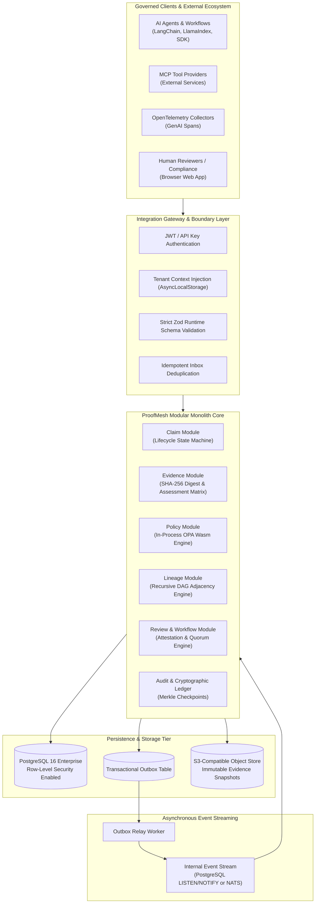
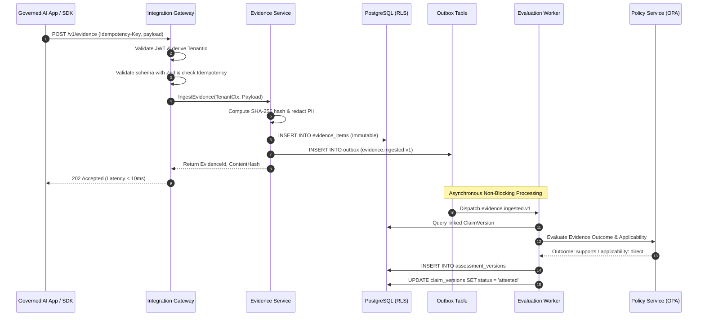
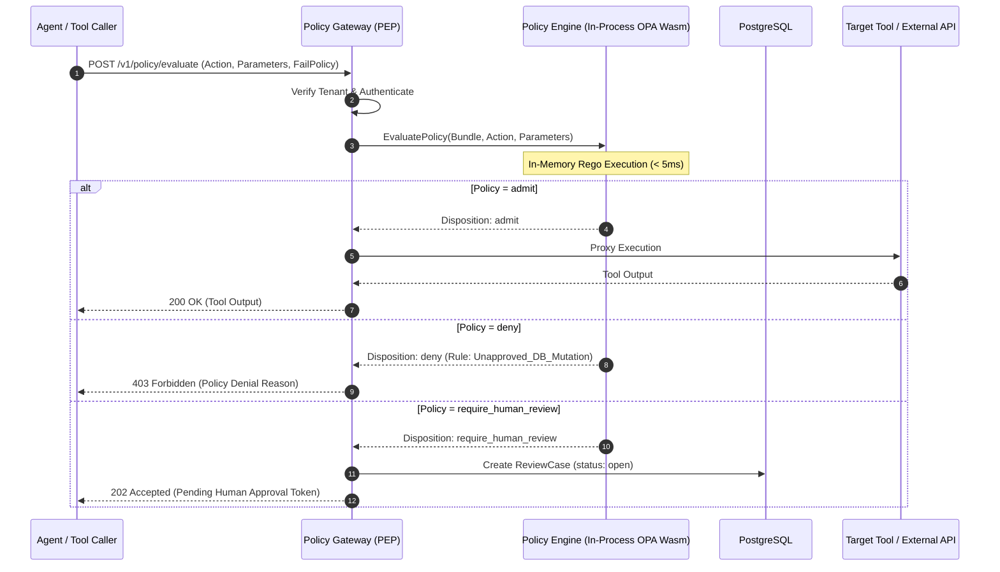

# ProofMesh System Architecture Specification

**Document:** `docs/architecture/system-architecture.md`  
**Version:** 1.0.0-PROPOSED  
**Date:** 2026-11-04  
**Author:** Lead Software Architect and Engineering Orchestrator  
**Status:** Baselined Architecture Specification  

---

## 1. System Overview & Architectural Paradigm

ProofMesh is architected as an **integration-first, evidence-driven modular monolith**. It captures telemetry, evaluates policies, tracks claims, and persists immutable audit trails for AI systems without introducing unnecessary microservice complexity.

### Core Architectural Decisions
- **Modularity**: Cohesive domain modules (`claims`, `evidence`, `policy`, `lineage`, `reviews`) communicating via typed in-process interfaces and an internal domain event bus.
- **Transactional Outbox**: Decouples database mutations from asynchronous event streaming, guaranteeing at-least-once event publication without distributed two-phase commit transactions.
- **Strict Trust Isolation**: The public internet and third-party AI agents reside outside the trust perimeter. Ingestion gateways enforce runtime schema validation, authentication, and tenant isolation before payloads reach domain services.

---

## 2. Logical Architecture

---

## 3. Sequence Diagrams

### 3.1 Asynchronous Evidence Ingestion & Claim Evaluation

---

### 3.2 Synchronous Policy Enforcement & Admission Gate

---

## 4. Component Architecture & System Boundaries

### 4.1 Integration Gateway & Protocol Adapters
- **OpenTelemetry GenAI Adapter**: Maps incoming OTLP HTTP/gRPC traces into canonical ProofMesh evidence items. Extracts token counts, model names, and prompt hashes.
- **Model Context Protocol (MCP) Proxy**: Implements standard MCP JSON-RPC protocol. Acts as an inline Policy Enforcement Point (PEP) intercepting tool requests.
- **Webhook Adapter**: Validates HMAC-SHA256 signatures, unpacks payloads, and handles timestamp anti-replay verification.
- **Switch Protocol Adapter**: Maintains persistent WebSocket/SSE connections with agent runtimes, managing session resumes (`session/resume`) and event synchronization.

### 4.2 Inbox/Outbox & Idempotent Processing
- **Transactional Outbox**: All domain events are inserted into an `outbox` table within the same database transaction that updates business entities. This eliminates race conditions and ensures zero event loss.
- **Outbox Relay**: A high-efficiency background worker polls the `outbox` table using `FOR UPDATE SKIP LOCKED` and publishes events to consumers.
- **Idempotent Inbox**: Incoming requests containing `Idempotency-Key` are verified against the `inbox_events` table. If previously processed, the cached response is returned immediately.

### 4.3 Database & Object Storage Boundaries
- **PostgreSQL 16 (Primary Datastore)**: Stores relational metadata, claim versions, evaluations, audit events, and lineage graph edges. Enforces multi-tenancy via Row-Level Security (RLS).
- **S3-Compatible Object Storage**: Stores large evidence payloads, raw document files (PDFs), context packets, and signed audit export archives. Payloads are referenced by SHA-256 content-addressable URIs.

### 4.4 Policy Enforcement Points (PEPs)
- **In-Process OPA WebAssembly Evaluator**: Rego policy bundles compiled to WebAssembly (Wasm) run directly within the Node.js application process, achieving sub-millisecond evaluation latency without network overhead.
- **Dynamic Bundle Sync**: A background polling routine checks the Policy Bundle Service every 60 seconds, verifying Ed25519 digital signatures before hot-swapping active Wasm policy instances.

### 4.5 Customer-Controlled Deployment & Data Plane
ProofMesh supports two operational topologies:
1. **Fully Managed SaaS Plane**: ProofMesh hosts both the control plane (dashboard, policy distribution) and data plane (telemetry ingestion, database).
2. **Customer-Controlled Hybrid Data Plane**: Customers run the ProofMesh Docker/Kubernetes container within their own VPC/cloud account. Raw evidence payloads and database records never leave the customer's perimeter; only anonymized policy metric heartbeats flow back to the central control plane.

---

## 5. Failure Domains & Recovery Paths

| Failure Scenario | Impact | Recovery Path |
| :--- | :--- | :--- |
| **Database Network Partition** | Ingestion & evaluation temporarily blocked. | Gateway buffers events in local disk spool; retries with exponential backoff. Ingestion endpoints return `503 Service Unavailable` with `Retry-After`. |
| **Policy Engine Timeout** | Synchronous enforcement requests delayed. | Evaluates `failPolicy`: If `fail_open`, admits request with warning; if `fail_closed`, rejects with 403. |
| **Object Store Outage** | Cannot persist raw evidence payloads. | Ingestion buffers payload metadata in PostgreSQL; raw blob upload deferred to background retry queue. |
| **Outbox Worker Crash** | Asynchronous domain events delayed. | Standby outbox worker picks up unprocessed rows via `SKIP LOCKED`. Zero event loss. |
