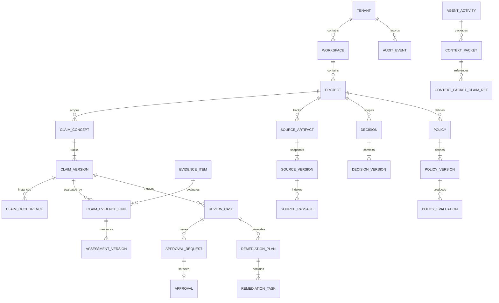

# ProofMesh Domain Model Specification

**Document:** `docs/data-model/domain-model.md`  
**Version:** 1.0.0-PROPOSED  
**Date:** 2026-11-04  
**Author:** Lead Software Architect and Engineering Orchestrator  
**Status:** Baselined Architecture Specification

---

## 1. Executive Domain Architecture & Semantic Axes

The ProofMesh domain model translates raw AI executions, retrieved documents, and external events into an authoritative, tamper-evident governance ledger.

### 1.1 Non-Negotiable Semantic Boundaries

The model strictly isolates four orthogonal conceptual dimensions:

1. **Claim Lifecycle**: The workflow state of an assertion (`draft`, `submitted`, `evaluating`, `attested`, `disputed`, `rejected`, `archived`).
2. **Evidence Outcome**: The epistemic relationship of an evidence item to a claim (`supports`, `refutes`, `inconclusive`, `contradictory`).
3. **Evidence Applicability**: The contextual relevance of the evidence (`direct`, `analogous`, `contextual`, `inapplicable`).
4. **Policy Disposition**: The operational decision returned by policy evaluation (`admit`, `deny`, `require_human_review`, `warn`, `remediate`).

### 1.2 Bitemporal Semantics

To ensure complete historical audibility, all core governance entities incorporate bitemporal modeling:

- **Valid Time (`valid_from`, `valid_to`)**: The period during which the assertion or fact was true in the real world.
- **Transaction / Recorded Time (`recorded_at`, `created_at`)**: The physical timestamp when the system persisted the record. Once written, transaction time is permanently immutable.

---

## 2. Entity Specifications by Functional Cluster

---

### Cluster 1: Organizational Hierarchy & Access Management

#### 1.1 `Tenant`

- **Purpose**: Top-level administrative and billing isolation boundary.
- **Attributes**:
  - `id` (UUID, PK)
  - `name` (string, max 100)
  - `slug` (string, unique, max 50)
  - `status` (`active` | `suspended` | `deprovisioned`)
  - `settings` (JSONB: default retention, encryption config, failover preferences)
  - `created_at` (TIMESTAMPTZ, immutable)
  - `updated_at` (TIMESTAMPTZ)
- **Invariants**: All database queries must enforce tenant scoping. Tenant deprovisioning soft-deletes access while preserving audit logs.

#### 1.2 `Workspace`

- **Purpose**: Logical organizational grouping within a tenant (e.g. division, department).
- **Attributes**: `id` (UUID, PK), `tenant_id` (UUID, FK -> `Tenant`), `name` (string), `created_at` (TIMESTAMPTZ).

#### 1.3 `Project`

- **Purpose**: Operational container for claims, policies, integrations, and review workflows.
- **Attributes**: `id` (UUID, PK), `tenant_id` (UUID, FK), `workspace_id` (UUID, FK), `key` (string, e.g. "KYC-BOT"), `name` (string), `created_at` (TIMESTAMPTZ).

#### 1.4 `User` & `Principal`

- **Purpose**: Represents human actors and automated machine identities.
- **Attributes (`Principal`)**:
  - `id` (UUID, PK)
  - `tenant_id` (UUID, FK)
  - `type` (`human_user` | `service_account` | `agent_identity`)
  - `identifier` (string, unique per tenant, e.g. email or client_id)
  - `display_name` (string)
  - `is_active` (boolean)
  - `created_at` (TIMESTAMPTZ)

#### 1.5 `Role` & `RoleAssignment`

- **Purpose**: Granular RBAC supporting `admin`, `compliance_officer`, `auditor`, `developer`, `agent_ingest`.

#### 1.6 `Integration`

- **Purpose**: Registered external system connector (e.g. OpenTelemetry receiver, MCP Gateway, LangChain agent).
- **Attributes**: `id` (UUID, PK), `project_id` (UUID, FK), `protocol` (`otel` | `mcp` | `webhook` | `custom`), `config` (JSONB), `credentials_ref` (string, secret manager key), `status` (`active` | `disabled`).

---

### Cluster 2: Source Artifacts & Versioning

#### 2.1 `SourceArtifact`

- **Purpose**: Represents a persistent external information asset (e.g. regulatory document, PDF manual, codebase, API catalog).
- **Attributes**: `id` (UUID, PK), `project_id` (UUID, FK), `uri` (string, canonical locator), `mime_type` (string), `title` (string), `created_at` (TIMESTAMPTZ).

#### 2.2 `SourceVersion`

- **Purpose**: Immutable snapshot of a source artifact at a specific point in time.
- **Attributes**:
  - `id` (UUID, PK)
  - `source_artifact_id` (UUID, FK)
  - `version_hash` (string, SHA-256 of raw content)
  - `byte_size` (BIGINT)
  - `storage_location` (string, object storage URI)
  - `captured_at` (TIMESTAMPTZ)
  - `recorded_at` (TIMESTAMPTZ, immutable)
- **Invariants**: Content cannot be modified once `version_hash` is computed. New content creates a new `SourceVersion`.

#### 2.3 `SourcePassage`

- **Purpose**: Addressable section, chunk, or token range within a source version.
- **Attributes**: `id` (UUID, PK), `source_version_id` (UUID, FK), `passage_index` (INT), `content_text` (TEXT), `char_start` (INT), `char_end` (INT), `embedding_ref` (string, optional).

#### 2.4 `SourceRelationship`

- **Purpose**: Declared or inferred links between source artifacts (e.g. "Regulation B supersedes Regulation A").
- **Attributes**: `id` (UUID, PK), `source_version_id` (UUID, FK), `target_version_id` (UUID, FK), `relationship_type` (`supersedes` | `amends` | `cites` | `derives_from`).

#### 2.5 `SourceSnapshot`

- **Purpose**: Bound, tamper-evident manifest of all source versions active during an evaluation window.

---

### Cluster 3: Claim Management & Lifecycle

#### 3.1 `ClaimConcept`

- **Purpose**: The enduring semantic concept of an assertion across revisions (e.g. "Customer Eligibility Assessment").
- **Attributes**: `id` (UUID, PK), `project_id` (UUID, FK), `concept_key` (string, stable slug), `created_at` (TIMESTAMPTZ).

#### 3.2 `ClaimVersion`

- **Purpose**: The authoritative, revisioned state of a claim.
- **Attributes**:
  - `id` (UUID, PK)
  - `concept_id` (UUID, FK -> `ClaimConcept`)
  - `version_sequence` (INT, monotonically increasing per concept)
  - `statement` (TEXT, exact markdown/text of assertion)
  - `status` (`draft` | `submitted` | `evaluating` | `attested` | `disputed` | `rejected` | `archived`)
  - `qualifiers` (JSONB: domain, jurisdiction, score)
  - `valid_from` (TIMESTAMPTZ)
  - `valid_to` (TIMESTAMPTZ)
  - `recorded_at` (TIMESTAMPTZ, immutable)
- **Invariants**: Status transitions must follow `docs/data-model/state-machines.md`. Transitions to terminal states lock the revision from further edits.

#### 3.3 `ClaimOccurrence`

- **Purpose**: Real-time operational instances where a claim was made by an agent or user in a specific conversation/run.
- **Attributes**: `id` (UUID, PK), `claim_version_id` (UUID, FK), `agent_activity_id` (UUID, FK, optional), `context_packet_id` (UUID, FK, optional), `occurred_at` (TIMESTAMPTZ).

---

### Cluster 4: Evidence & Assessment

#### 4.1 `EvidenceItem`

- **Purpose**: An immutable unit of data ingested to corroborate or challenge claims.
- **Attributes**:
  - `id` (UUID, PK)
  - `tenant_id` (UUID, FK)
  - `project_id` (UUID, FK)
  - `evidence_type` (`runtime_trace` | `document_passage` | `tool_result` | `human_statement` | `metric_sample`)
  - `content_hash` (string, SHA-256)
  - `content_payload` (JSONB or raw storage reference)
  - `source_passage_id` (UUID, FK, optional)
  - `captured_at` (TIMESTAMPTZ)
  - `recorded_at` (TIMESTAMPTZ, immutable)

#### 4.2 `ClaimEvidenceLink`

- **Purpose**: Associative entity linking an evidence item to a specific claim version.
- **Attributes**: `id` (UUID, PK), `claim_version_id` (UUID, FK), `evidence_item_id` (UUID, FK), `linked_at` (TIMESTAMPTZ).

#### 4.3 `AssessmentVersion`

- **Purpose**: Evaluated judgment of how evidence affects a claim.
- **Attributes**:
  - `id` (UUID, PK)
  - `claim_evidence_link_id` (UUID, FK)
  - `outcome` (`supports` | `refutes` | `inconclusive` | `contradictory`)
  - `applicability` (`direct` | `analogous` | `contextual` | `inapplicable`)
  - `confidence_score` (NUMERIC(5,4), 0.0000 to 1.0000)
  - `rationale` (TEXT)
  - `is_stale` (BOOLEAN, default false; set true if underlying source version updates)
  - `evaluated_by_principal_id` (UUID, FK)
  - `evaluated_at` (TIMESTAMPTZ)

---

### Cluster 5: Agent Activities & Context Packets

#### 5.1 `AgentActivity`

- **Purpose**: Execution trace of an autonomous agent session, prompt execution, or tool run.
- **Attributes**: `id` (UUID, PK), `project_id` (UUID, FK), `session_key` (string), `model_id` (string), `prompt_tokens` (INT), `completion_tokens` (INT), `started_at` (TIMESTAMPTZ), `ended_at` (TIMESTAMPTZ).

#### 5.2 `ContextPacket`

- **Purpose**: The exact bundle of retrieved documents, tool outputs, and system prompts supplied to an agent at inference time.
- **Attributes**: `id` (UUID, PK), `agent_activity_id` (UUID, FK), `packet_hash` (string, SHA-256), `token_count` (INT), `created_at` (TIMESTAMPTZ).

#### 5.3 `ContextPacketClaimRef`

- **Purpose**: Explicit mapping identifying which claims were derived from which passages in a context packet.

---

### Cluster 6: Decisions & Governed Artifacts

#### 6.1 `Decision` & `DecisionVersion`

- **Purpose**: Authoritative enterprise actions governed by ProofMesh (e.g. loan approval, code commit admission, healthcare triage).
- **Attributes (`DecisionVersion`)**:
  - `id` (UUID, PK)
  - `decision_id` (UUID, FK)
  - `version_sequence` (INT)
  - `verdict` (`admitted` | `denied` | `admitted_with_remediation`)
  - `policy_evaluation_id` (UUID, FK)
  - `claim_version_id` (UUID, FK)
  - `decided_at` (TIMESTAMPTZ)

#### 6.2 `Artifact` & `ArtifactVersion`

- **Purpose**: Work products produced by the decision (e.g. signed PDF report, admitted PR commit, outbound email).

---

### Cluster 7: Lineage DAG & Coverage Records

#### 7.1 `TypedDependencyEdge`

- **Purpose**: Edges forming the append-only lineage Directed Acyclic Graph (DAG).
- **Attributes**:
  - `id` (UUID, PK)
  - `tenant_id` (UUID, FK)
  - `source_node_id` (UUID)
  - `source_node_type` (`source_artifact` | `evidence_item` | `claim_version` | `decision_version`)
  - `target_node_id` (UUID)
  - `target_node_type`
  - `edge_type` (`derives_from` | `supported_by` | `refuted_by` | `governed_by` | `attested_by`)
  - `capture_method` (`captured` | `declared` | `attested` | `inferred` | `unknown`)
  - `confidence_score` (NUMERIC(5,4), nullable)
  - `created_at` (TIMESTAMPTZ, immutable)
- **Invariants**: Graph queries reject cycles across transaction timestamps.

#### 7.2 `CoverageRecord`

- **Purpose**: Explicitly documents gaps, partial instrumentation, and unverified assumptions in dependency trees.
- **Attributes**:
  - `id` (UUID, PK)
  - `claim_version_id` (UUID, FK)
  - `coverage_status` (`complete` | `partial` | `uninstrumented_dependency`)
  - `known_percentage` (NUMERIC(5,2))
  - `unresolved_reasons` (JSONB array of strings)
  - `assessed_at` (TIMESTAMPTZ)
- **Invariant**: Impact reports must flag any `partial` or `uninstrumented` coverage; complete lineage cannot be claimed when gaps exist.

---

### Cluster 8: Policy Engine & Evaluation

#### 8.1 `Policy` & `PolicyVersion`

- **Purpose**: Versioned governance rules executed against claims and operations.
- **Attributes (`PolicyVersion`)**:
  - `id` (UUID, PK)
  - `policy_id` (UUID, FK)
  - `version_sequence` (INT)
  - `rego_code` (TEXT)
  - `bundle_digest` (string, SHA-256)
  - `is_active` (BOOLEAN)
  - `created_at` (TIMESTAMPTZ)

#### 8.2 `PolicyEvaluation`

- **Purpose**: Immutable record of a policy decision.
- **Attributes**:
  - `id` (UUID, PK)
  - `policy_version_id` (UUID, FK)
  - `action_type` (string)
  - `input_context_snapshot` (JSONB)
  - `disposition` (`admit` | `deny` | `require_human_review` | `warn` | `remediate`)
  - `remediation_notes` (TEXT, optional)
  - `evaluation_latency_ms` (INT)
  - `evaluated_at` (TIMESTAMPTZ, immutable)

---

### Cluster 9: Review, Approval & Attestation

#### 9.1 `ReviewCase`

- **Purpose**: Durable human-in-the-loop task generated when automated governance escalates.
- **Attributes**: `id` (UUID, PK), `claim_version_id` (UUID, FK), `status` (`open` | `assigned` | `in_review` | `resolved` | `escalated`), `severity` (`low` | `medium` | `high` | `critical`), `created_at` (TIMESTAMPTZ).

#### 9.2 `ReviewerAssignment`

- **Purpose**: Assigns specific authorized principals or roles to a review case.

#### 9.3 `ApprovalRequest` & `Approval`

- **Purpose**: Formal sign-off on a claim or decision.
- **Attributes (`Approval`)**:
  - `id` (UUID, PK)
  - `approval_request_id` (UUID, FK)
  - `approver_principal_id` (UUID, FK)
  - `verdict` (`approved` | `rejected` | `amended`)
  - `statement` (TEXT)
  - `digital_signature` (TEXT, optional Ed25519)
  - `approved_at` (TIMESTAMPTZ, immutable)

---

### Cluster 10: Remediation & Verification

#### 10.1 `RemediationPlan`

- **Purpose**: Action plan required when a policy returns `remediate` or a claim is rejected.
- **Attributes**: `id` (UUID, PK), `review_case_id` (UUID, FK), `status` (`draft` | `in_progress` | `verified` | `failed`), `created_at` (TIMESTAMPTZ).

#### 10.2 `RemediationTask`, `Execution`, `Verification`

- **Purpose**: Individual tasks (e.g. re-prompt agent, mask data, obtain new evidence) and their verification records.

---

### Cluster 11: Audit Trail & Integrity Checkpoints

#### 11.1 `AuditEvent`

- **Purpose**: Append-only audit record of every state modification.
- **Attributes**:
  - `id` (BIGSERIAL, PK)
  - `tenant_id` (UUID, FK)
  - `principal_id` (UUID, nullable)
  - `action` (string, e.g. `claim.transition`)
  - `entity_type` (string)
  - `entity_id` (UUID)
  - `payload_diff` (JSONB)
  - `payload_hash` (string, SHA-256)
  - `prev_event_hash` (string, SHA-256 for cryptographic chain)
  - `recorded_at` (TIMESTAMPTZ, immutable default clock_timestamp())
- **Invariants**: No `UPDATE` or `DELETE` permissions granted to any role.

#### 11.2 `AuditCheckpoint`

- **Purpose**: Periodic cryptographic checkpoint sealing audit blocks into an immutable Merkle root.
