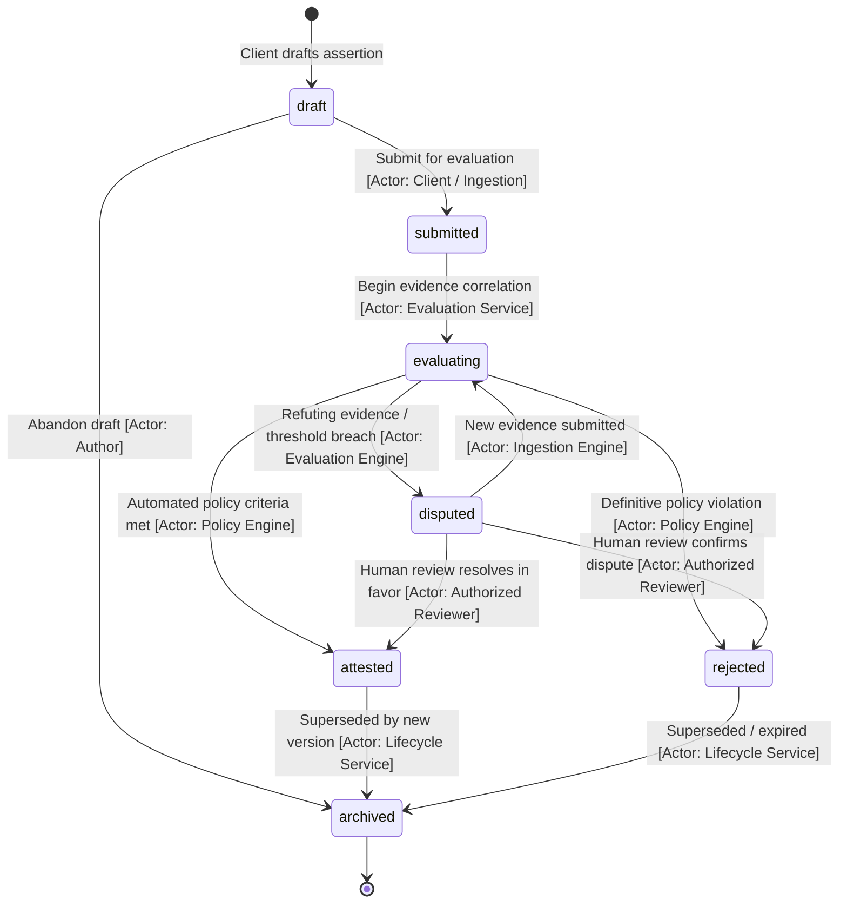
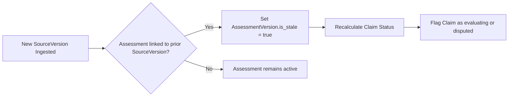
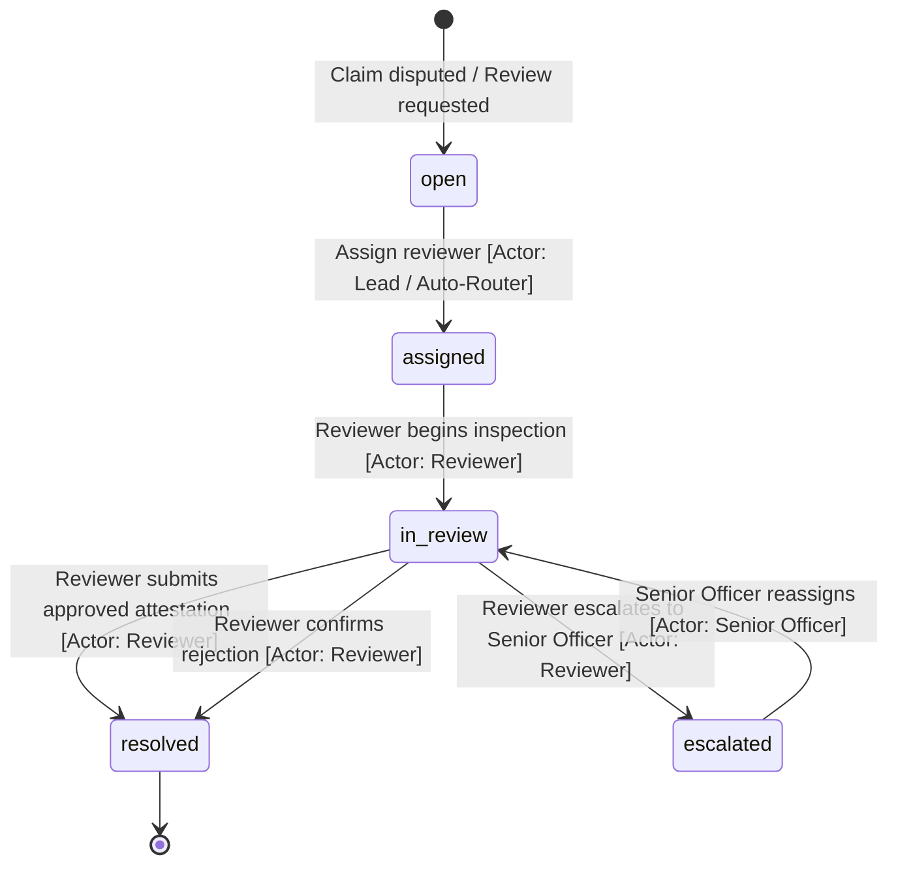

# ProofMesh State Machines & Domain Semantics

**Document:** `docs/data-model/state-machines.md`  
**Version:** 1.0.0-PROPOSED  
**Date:** 2026-11-04  
**Author:** Lead Software Architect and Engineering Orchestrator  
**Status:** Baselined Architecture Specification  

---

## 1. Domain Semantics & Invariants

### 1.1 Separation of Semantic Dimensions
The core domain enforces strict isolation between four independent semantic dimensions:
- **Claim Lifecycle**: Describes the formal verification status of an assertion within the governance system.
- **Evidence Outcome**: Describes the epistemic finding of an evaluation (`supports`, `refutes`, `inconclusive`, `contradictory`).
- **Evidence Applicability**: Describes the relevance of evidence to the claim's domain (`direct`, `analogous`, `contextual`, `inapplicable`).
- **Policy Disposition**: Describes the operational gatekeeping verdict (`admit`, `deny`, `require_human_review`, `warn`, `remediate`).

*Invariant*: An evidence item having an outcome of `supports` does **not** automatically transition a claim to `attested`. Attestation requires passing mandatory policy evaluation and/or authorized human sign-off.

---

### 1.2 Temporal Semantics: Valid Time vs. Recorded Time
Every governed fact in ProofMesh possesses two distinct time vectors:
- **Valid Time**: `[valid_from, valid_to]` represents the window during which the statement was true in the real world or target domain.
- **Recorded / Transaction Time**: `recorded_at` represents the physical timestamp when ProofMesh persisted the record. Once committed, `recorded_at` is permanently immutable.

---

### 1.3 Immutable Historical Record Definition
A record in ProofMesh is classified as an **Immutable Historical Record** if:
1. It represents an authoritative event, snapshot, evaluation, or decision.
2. Database triggers strictly prohibit `UPDATE` and `DELETE` SQL operations on the table.
3. Every row contains a SHA-256 content digest and a pointer to the cryptographic audit chain.
4. Corrective actions are executed solely by creating a new version with an incremented sequence number and a reference to the superseded version.

---

## 2. Claim Lifecycle State Machine

### State Transition Matrix: `ClaimVersion`

| Current State | Event / Trigger | Guard Conditions | Target State | Authorized Actor | Emitted Event |
| :--- | :--- | :--- | :--- | :--- | :--- |
| `draft` | `SUBMIT_CLAIM` | Valid statement, schema conforms | `submitted` | Client Principal / SDK | `claim.submitted.v1` |
| `draft` | `ABANDON_DRAFT` | None | `archived` | Author Principal | `claim.archived.v1` |
| `submitted` | `START_EVALUATION` | Evidence items linked | `evaluating` | Evaluation Engine | `claim.evaluating.v1` |
| `evaluating` | `AUTO_ATTEST` | Policy admits, zero refuting evidence, confidence >= threshold | `attested` | Policy Service | `claim.attested.v1` |
| `evaluating` | `FLAG_DISPUTE` | Evidence outcome = `refutes` OR policy = `require_human_review` | `disputed` | Evaluation Engine | `claim.disputed.v1` |
| `evaluating` | `REJECT_CLAIM` | Policy = `deny` | `rejected` | Policy Service | `claim.rejected.v1` |
| `disputed` | `RESOLVE_ATTEST` | Approval signed by Compliance Officer | `attested` | Authorized Reviewer | `claim.attested.v1` |
| `disputed` | `CONFIRM_REJECTION` | Rejection signed by Compliance Officer | `rejected` | Authorized Reviewer | `claim.rejected.v1` |
| `disputed` | `INGEST_NEW_EVIDENCE` | Additional evidence linked | `evaluating` | Ingestion Engine | `claim.evaluating.v1` |
| `attested` | `SUPERSEDE` | New version published | `archived` | Lifecycle Service | `claim.archived.v1` |
| `rejected` | `SUPERSEDE` | New version published | `archived` | Lifecycle Service | `claim.archived.v1` |

*Security Guard*: No LLM prompt completion or untrusted webhook can invoke `AUTO_ATTEST` or `RESOLVE_ATTEST`.

---

## 3. Evidence Assessment Stale Invalidation Semantics

### The Stale Assessment Problem
When a source artifact (e.g. regulatory PDF or codebase) is updated, a new `SourceVersion` is created. Existing evidence passages and claim assessments derived from the older version become potentially obsolete.

### Rules for Stale Invalidation
1. **Source Version Trigger**: Ingesting a new `SourceVersion` for a given `SourceArtifact` automatically evaluates all downstream `AssessmentVersion` records.
2. **Flagging Stale**: Any assessment referencing a superseded `SourceVersion` has its `is_stale` flag set to `true`.
3. **Claim Re-Evaluation**: If a claim's attestation depended on an assessment that becomes stale:
   - The claim transitions to `evaluating`.
   - If automated re-evaluation cannot confirm validity against the new source version, the claim transitions to `disputed`.
4. **Historical Preservation**: Stale assessments are **never deleted**; they remain visible in the historical lineage DAG with `is_stale: true`.

---

## 4. Lineage Dependency & Coverage Semantics

### 4.1 Dependency Classification
Lineage edges in `typed_dependency_edges` store three orthogonal properties:
1. **Edge Type**: `derives_from`, `supported_by`, `refuted_by`, `governed_by`, `attested_by`.
2. **Capture Method**:
   - **`captured`**: Observed directly from system telemetry or runtime instrumentation.
   - **`declared`**: Explicitly stated in static configuration, code manifests, or prompts.
   - **`attested`**: Cryptographically signed or verified by an authorized human or service identity.
   - **`inferred`**: Deduced via heuristic, model analysis, or probabilistic linkage.
   - **`unknown`**: Relationship is ambiguous or unverified.
3. **Verification State**: `unverified`, `verified`, `disputed`.

### 4.2 Impact of Partial or Unknown Coverage
When an external system, model provider, or tool boundary cannot be instrumented:
- A `CoverageRecord` is created with status `partial` or `uninstrumented_dependency`.
- **Impact Report Rule**: Any governance report, audit export, or compliance assessment operating on a graph containing `unknown` or `partial` coverage **must explicitly disclaim complete lineage**. The UI must visually display dashed edges and alert banners for incomplete subgraphs.

---

## 5. Review Case & Approval Workflow State Machine

### Transition Invariants
- A `ReviewCase` cannot be marked `resolved` without an associated, cryptographically stored `Approval` entity specifying verdict and statement.
- Multiple reviewers can be assigned, but resolution requires quorum according to project policy.
