# ProofMesh Subagent Ownership & Delegation Guide

**Document:** `docs/engineering/agent-ownership.md`  
**Author:** Lead Software Architect and Engineering Orchestrator  
**Status:** Authoritative Repository Governance

---

## 1. Overview & Delegation Model

ProofMesh utilizes a hub-and-spoke multi-agent engineering architecture. The **Lead Software Architect** is the sole integration owner, central orchestrator, and final decision-maker. Specialized subagents execute bounded research, implementation, verification, and audit tasks.

```mermaid
flowchart TD
    Lead["Lead Software Architect<br/>(Integration Owner & Decision Maker)"]

    subgraph ReadOnlyAgents["Read-Only Specialist Subagents"]
        RA["Research Analyst<br/>(docs/research/)"]
        AA["Architecture Auditor<br/>(ADR & Boundary Conformance)"]
        SR["Security Reviewer<br/>(Threat Models & CVSS Findings)"]
    end

    subgraph ImplementationAgents["Implementation Subagents (Isolated Worktrees)"]
        BE["Backend Engineer<br/>(src/backend/, test/backend/)"]
        DE["Data Engineer<br/>(src/db/, migrations/)"]
        IE["Integration Engineer<br/>(src/integrations/, test/integrations/)"]
        FE["Frontend Engineer<br/>(src/frontend/, test/frontend/)"]
    end

    subgraph QualityAgent["Verification Subagent"]
        QA["QA Engineer<br/>(test/, docs/phase-reports/)"]
    end

    Lead -->|Research Brief| RA
    Lead -->|Bounded Vertical Slice| BE
    Lead -->|Schema & Migrations| DE
    Lead -->|Connectors & Protocols| IE
    Lead -->|UI & Lineage Views| FE
    Lead -->|Verification Brief| QA
    Lead -->|Security Audit Request| SR
    Lead -->|Architecture Review Request| AA

    BE -.->|Diff & Report| Lead
    DE -.->|Diff & Report| Lead
    IE -.->|Diff & Report| Lead
    FE -.->|Diff & Report| Lead
    QA -.->|Test Execution Evidence| Lead
    SR -.->|Vulnerability Assessment| Lead
    AA -.->|Conformance Sign-off| Lead
```



---

## 2. File & Directory Ownership Matrix

To prevent merge conflicts, regression, and race conditions, file ownership is strictly segregated. **Concurrent implementation agents must never be assigned overlapping file paths.**

| Subagent                 | Primary File Ownership                 | Permitted Write Paths                                                                             | Forbidden Paths                                                             | Default Mode                                     |
| :----------------------- | :------------------------------------- | :------------------------------------------------------------------------------------------------ | :-------------------------------------------------------------------------- | :----------------------------------------------- |
| **Research Analyst**     | None (Analysis briefs)                 | _None_                                                                                            | All codebase & config files                                                 | Read-only                                        |
| **Backend Engineer**     | Domain models, application services    | `src/backend/**`<br/>`test/backend/**`                                                            | `src/frontend/**`<br/>`src/db/migrations/**`<br/>`AGENTS.md`, `docs/adr/**` | Isolated Branch                                  |
| **Data Engineer**        | Schemas, migrations, RLS policies      | `src/db/migrations/**`<br/>`src/db/schemas/**`<br/>`test/db/**`<br/>`docs/data-model/**`          | `src/frontend/**`<br/>`src/integrations/**`<br/>`AGENTS.md`                 | Isolated Branch                                  |
| **Integration Engineer** | Adapters, webhook handlers, connectors | `src/integrations/**`<br/>`src/connectors/**`<br/>`test/integrations/**`<br/>`docs/operations/**` | `src/frontend/**`<br/>`src/db/migrations/**`<br/>`AGENTS.md`                | Isolated Branch                                  |
| **Frontend Engineer**    | React views, components, styles        | `src/frontend/**`<br/>`src/ui/**`<br/>`test/frontend/**`                                          | `src/backend/**`<br/>`src/db/**`<br/>`src/integrations/**`                  | Isolated Branch                                  |
| **QA Engineer**          | Test suites, test fixtures             | `test/**`<br/>`tests/**`<br/>`docs/phase-reports/**`                                              | `src/**` (All production code)<br/>`docs/adr/**`                            | Read-only (Default)<br/>Write on test assignment |
| **Security Reviewer**    | Security reports                       | `docs/security/**`                                                                                | All application source code (`src/**`)                                      | Read-only                                        |
| **Architecture Auditor** | Conformance reports                    | `docs/architecture/**`                                                                            | All application source code (`src/**`)                                      | Read-only                                        |

---

## 3. Delegation Runbook & Parameters

When invoking a subagent via `invoke_subagent`, the Lead Architect configures three critical parameters:

### Parameter Guidelines

1. **`TypeName`**: Must match the subagent identifier (e.g. `research-analyst`, `backend-engineer`).
2. **`Model`**:
   - `flash`: Used for `research-analyst` and rapid fact lookups.
   - `pro`: Used for `security-reviewer` and `architecture-auditor` for deep reasoning, complex threat modeling, and boundary analysis.
   - `inherit`: Used for implementation engineers (`backend-engineer`, `data-engineer`, `integration-engineer`, `frontend-engineer`, `qa-engineer`).
3. **`Workspace`**:
   - `inherit`: Used for all read-only agents (`research-analyst`, `security-reviewer`, `architecture-auditor`).
   - `branch`: Used for all coding subagents to guarantee complete Git worktree isolation.

### Delegation Workflow

```text
1. Scope Definition:
   - Identify phase requirement from docs/product/.
   - Determine target subagent and bounded file scope.
   - Confirm no other active agent touches that file scope.

2. Worktree Dispatch:
   - Invoke subagent with Workspace="branch" (for coding) or Workspace="inherit" (for review).
   - Supply explicit requirements, allowed files, forbidden files, and acceptance tests.

3. Completion Review:
   - Inspect subagent's structured report and git diff.
   - Run affected test suites centrally before merging.
   - Request Architecture Auditor and Security Reviewer sign-off.

4. Central Integration:
   - Lead Architect merges worktree branch into main.
   - Update docs/product/traceability-matrix.md.
```

---

## 4. Subagent Reporting & Escalation Standards

Every subagent must submit a structured completion report back to the Lead Architect before its work is considered for integration:

1. **Summary of Changes**: Exact list of files created or modified.
2. **Verification Evidence**: Exact command line executed, exit code, and test counts.
3. **Non-Negotiable Rule Checklist**: Confirmation of boundary validation, tenant isolation, and lack of stubs/TODOs.
4. **Escalations / Limitations**: Explicit flagging of any ambiguities, blocked dependencies, or contract conflicts.

### Automatic Escalation Triggers

A subagent must immediately halt work and escalate to the Lead Architect when:

- Shared contracts, public API schemas, or database tables need alteration.
- Official documentation is ambiguous, deprecated, or contradictory.
- A Critical or High security vulnerability is uncovered.
- A previously passing test fails or exhibits non-deterministic behavior.
